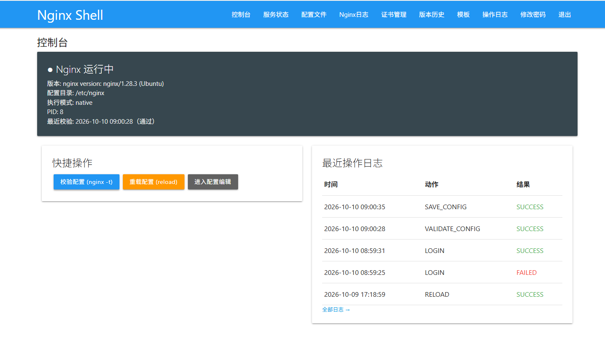
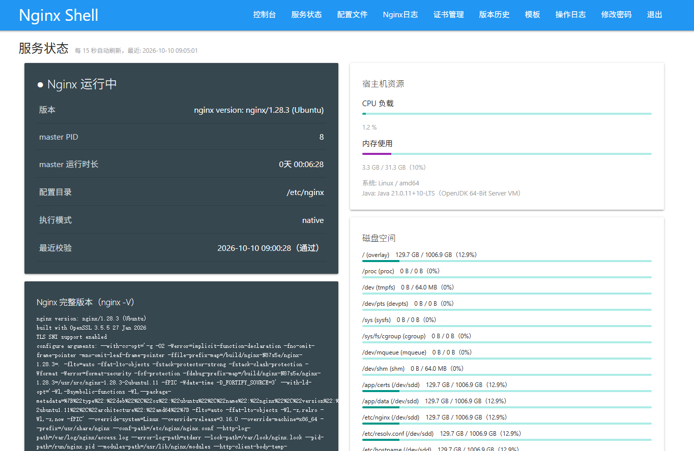

# Nginx Shell

<p align="left">
  
  
  
  
</p>

<p align="left">🇺🇸 English | 🇨🇳 <a href="README.md">简体中文</a></p>

**Nginx configuration console** — a lightweight single-admin web panel deployed next to your nginx (same host, or the same container). Edit config → automatic `nginx -t` validation → one-click `reload`, with full version history and audited operations along the way. Built on the self-developed plinth stack from [MinIO Shell](https://github.com/shiyi25928988/minio-shell) (Guice 7 + Jetty 12 + embedded H2) — no Spring Boot, no external dependencies, ships as a single fat jar.

## Screenshots

### Console

nginx runtime status at a glance (version / config directory / exec mode / PID / last validation result), plus recent audit logs, recent config changes, and one-click actions.



### Service Status

nginx master liveness / uptime / full compile options (`nginx -V`), live CPU / memory / disk bars for the host, refreshed every 15 seconds.



## Features

**Config files**
- **Online editing** — config directory file tree with CodeMirror highlighting (custom nginx lexer mode, fixes the native mode painting whole paths/regexes red); one-click full-screen editor. Every save runs `nginx -t` automatically and restores the previous content on failure (new files are removed) — the config on disk is always in a state nginx can actually load.
- **Validate unsaved content** — validate whatever is still in the editor (nginx.conf / conf.d snippets / brand-new files) before saving: the candidate is temporarily written to the file's real location, participates in a full-tree `nginx -t`, then everything is reverted. Nothing is persisted.
- **Upload-and-overwrite** — replace a file (e.g. nginx.conf) with a local `.conf`; admin password re-confirmation required; the before/after diff lands in version history automatically.

**Apply & trace**
- One-click reload — `nginx -s reload`, with an optional "auto-reload after successful save" checkbox.
- **Traceable changes** — every save/upload/delete records full old/new content + MD5 + operator + reason. Side-by-side diff (removed lines red on the left, added lines green on the right, line numbers, switchable to "version vs current disk"). Deliberately **no one-click rollback**: restoring old content is done by copying the version's text back into the editor through the same validation pipeline — one extra human confirmation.
- **Audit log** — login/save/delete/template/validate/reload, every action recorded (with client IP and command-output excerpts), filterable and paginated.

**Operations panels**
- **Service status** — nginx process liveness / uptime / full build options, host CPU / memory / disk-partition progress bars, 15-second auto refresh; pure JDK capabilities, zero dependencies.
- **Nginx logs** — `error_log` / `access_log` **auto-discovery** (parses directives in your config + `nginx -V` binary defaults; follows config changes automatically after reload). Tail 100–5000 lines by reading the end of the file (multi-GB logs don't blow up memory), keyword filtering, auto-refresh. In docker mode, container logs are read via `docker exec tail` — no shell involved. Tail paths are restricted to the discovered allow-list (no arbitrary file reads).

**HTTPS / templates**
- **Certificate management** — inventory auto-discovered from `ssl_certificate` / `ssl_certificate_key` directives: CN / SANs / issuer / expiry / key-match check via signature challenge; <7 days red, <30 days orange expiry warnings. Certificates are consolidated under `cert.dir` (default `/app/certs`) — **system directories (/etc/ssl) are never touched by the panel**. Replacing a cert requires an admin password re-confirmation, PEM/key pairing is pre-checked, and a failed `nginx -t` after replacement auto-restores the originals. Built-in self-signed certificate generation (RSA 2048 / SHA-256 / SAN).
- **Embedded templates** — 8 templates (main config skeleton, static site, HTTP reverse proxy, WebSocket proxy, load balancer, HTTPS, gzip+security headers, asset caching) with `{{variable}}` forms, live preview, and the same validation pipeline on save.

**Deployment modes**
- `native` — panel and nginx on the same host: reads/writes the config directory and drives the nginx binary (optional sudo prefix).
- `docker` all-in-one — base image ships JDK 21 + nginx; the panel manages the nginx master **inside the same container** (`nginx -t` / `-s reload`).
- `docker exec` — panel and nginx in separate containers, controlled via `docker exec <nginx-container> nginx ...`.
- **Replace a binary-installed nginx** (`docker-compose.linux.yml`) — `network_mode: host` so the containerized nginx listens on 80/443 directly, with config/logs/panel data persisted to `/data/nginx-shell`.

**Security & packaging**
- Path allow-listing (all file access locked inside `cert.dir` / `conf.dir`), a fixed command whitelist (`nginx -t/-v/-s reload` only, launched via ProcessBuilder — no shell), single admin + session auth, atomic writes so a crash never leaves half a config.
- Single fat jar + embedded H2. First startup auto-creates the admin account (`admin/admin123`, empty-database only — change it in production).

## Architecture

| Layer | Technology |
|---|---|
| Runtime | Jetty 12 (embedded, EE10 Servlet 6.1) |
| IoC / routing | Guice 7 + self-developed plinth framework (`@HttpService` / `@HttpPath` scanned dispatching) |
| Auth | Sa-Token 1.44 (single admin, `@AUTH(orRole="admin")`) |
| ORM / storage | MyBatis 3 + mybatis-guice + H2 2.2 |
| UI | j2html server-side rendering + Materialize + jQuery + CodeMirror 5 |
| Build | Java 21 + maven-shade-plugin single fat jar |

## Quick start

### 1. Build the jar

```bash
mvn package -DskipTests
# output: target/nginx-shell.jar
```

### 2. Deploy next to nginx (native mode, recommended)

```bash
sudo mkdir -p /opt/nginx-shell
sudo cp target/nginx-shell.jar /opt/nginx-shell/
sudo cp deploy/nginx-shell.service /etc/systemd/system/
sudo systemctl daemon-reload && sudo systemctl enable --now nginx-shell
```

Then open `http://<server>:8080/page/login` (`admin/admin123` — change the password on first login).

If the panel runs as a non-root user, set `nginx.sudo=true` and grant a limited passwordless sudo for the nginx commands (see comments at the top of `deploy/nginx-shell.service`).

### 3. Local development

```bash
java -Dnginx.conf.dir=/etc/nginx -jar target/nginx-shell.jar
```

### 4. Docker all-in-one (panel + nginx in one container)

```bash
docker build -f Dockerfile.base -t nginx-shell-base:1.0 .   # JDK 21 + nginx
docker build -t nginx-shell:1.0 .
docker compose -f docker-compose.yml up -d
```

`docker-compose.linux.yml` (production) runs with `network_mode: host` to **replace a binary-installed nginx** while persisting config/logs/panel data under `/data/nginx-shell`. Migration steps are documented at the top of the file.

## Configuration

Set via `application.properties`, `-D` system properties, or environment variables (mapped in `docker/entrypoint-app.sh`):

| Key | Default | Description |
|---|---|---|
| `server.port` | 8080 | panel port |
| `nginx.conf.dir` | /etc/nginx | nginx configuration root (browse/read-write scope) |
| `cert.dir` | /app/certs | panel certificate workspace (uploads & self-signed; /etc/ssl is off-limits) |
| `nginx.bin` | nginx | nginx binary path (native mode) |
| `nginx.exec.mode` | native | `native` / `docker` |
| `nginx.docker.container` | nginx | container name (docker mode) |
| `nginx.pid.file` | /run/nginx.pid | master PID probe (empty = skip) |
| `nginx.sudo` | false | prefix native commands with `sudo -n` |
| `admin.default.username/password` | admin/admin123 | built-in admin (first empty-DB boot only) |

## License

MIT — see [LICENSE](LICENSE).
